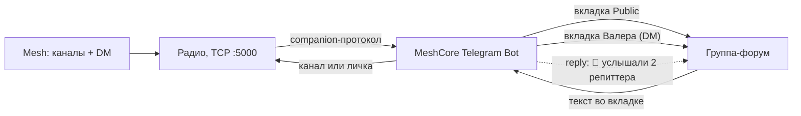

# MeshCore Telegram Bot — мост ZephCore/MeshCore ↔ Telegram

Двусторонний мост между mesh-сетью (радио ZephCore, роль companion) и **группой-форумом**
в Telegram: каждому mesh-каналу и каждому личному диалогу соответствует своя вкладка.
Сообщения из mesh постятся в свою вкладку, сообщения вкладок уезжают в mesh, и бот отвечает
reply-ом, сколько репиттеров услышало каждую канальную отправку.



## Структура

```
cmd/meshcore-telegram-bot/   точка входа: сборка компонентов и запуск
internal/config/             конфиг: .env + переменные окружения
internal/telegram/           клиент Telegram Bot API
internal/companion/          companion-протокол радио (TCP, бинарные фреймы)
internal/bridge/             связка сторон: доставка, форматы, счётчик репиттеров
docker/                      Dockerfile и docker-compose
```

## Требования

- Радио с ролью **companion** и WiFi-компаньеном (`capabilities: wifi: true`, TCP :5000).
  USB/BLE-транспорты бот не поддерживает.
- Для счётчика репиттеров — прошивка ZephCore ≥ 1.18.1 с CLI-командой `send.heard`.
- Telegram-группа с **включёнными Темами** (Topics / форум-режим); бот — админ с правом
  создания тем, и с **выключенным privacy mode** (BotFather → `/setprivacy` → Disable),
  иначе он не видит обычные сообщения группы.

## Настройка

Конфиг лежит в файле `.env` (формат `KEY=VALUE`, `#` — комментарии):

```bash
cp .env.example .env   # и заполнить значения
```

| Ключ            | По умолчанию     | Что                                             |
|-----------------|------------------|-------------------------------------------------|
| `BOT_TOKEN`     | —, обязателен    | токен от @BotFather                              |
| `TARGET_CHAT_ID`| —, обязателен    | числовой id группы-форума (у групп отрицательный, `-100…`) |
| `RADIO_ADDR`    | `127.0.0.1:5000` | `ip:port` радио                                  |
| `CHANNEL_NAME`  | `Public`         | канал по умолчанию — сюда идёт вкладка General   |
| `TOPICS_FILE`   | `topics.json`    | соответствие «вкладка ↔ mesh-адрес» между перезапусками |
| `TZ_OFFSET`     | `5`              | часовой пояс времени в шапках сообщений (часы, дробные можно: `5.5`) |
| `ADMIN_ID`      | —                | TG id, чей «да» согласует команды из LoRa; пусто — любой участник группы |

Путь к файлу задаётся переменной `CONFIG_FILE` (по умолчанию `.env`; если файла нет
по умолчанию — работают только переменные окружения). **Переменные окружения переопределяют
файл** — так удобно подменять значения в Docker.

`TARGET_CHAT_ID` — только числовой id, не `@username`. Узнать: переслать любое сообщение
группы боту `@userinfobot` или `@JsonBot`.

## Вкладки (topics)

Одна группа-форум на всю mesh-сеть. Правила маршрутизации:

| Вкладка | Куда в mesh |
|---|---|
| по имени канала (`Public`, …) | канальное сообщение в этот канал |
| по имени контакта (`Валера`, …) | личное сообщение контакту |
| General (без вкладки) | канал по умолчанию (`CHANNEL_NAME`) |
| чужая вкладка (создана руками) | игнорируется |

Вкладки создаются автоматически: для каналов — при подключении к радио, для контактов —
при первом сообщении. **При старте бот сверяется с группой**: существующие вкладки
привязываются по сохранённому id (ручные переименования в Telegram сохраняются —
бот их не перетирает) или по имени, создаются только недостающие — поэтому
потеря `topics.json` не приводит к дубликатам (Bot API не умеет перечислять темы, имена
ищутся обходом thread_id; в очень больших группах со старыми вкладками обход ограничен
~300 id). Соответствие вкладка ↔ адрес сохраняется в `TOPICS_FILE`, поэтому
после перезапуска бот переиспользует вкладки, а не плодит дубликаты. Имя вкладки-контакта —
имя из контактов радио: если при первом сообщении контакт ещё без имени
(авто-добавленный, advert не слышали), вкладка называется `dm-XXXX`, а бот
перечитывает список контактов и **переименовывает** вкладку в имя контакта,
как только оно появляется.

При первом подключении к радио бот пишет в вкладку `Public` (только в Telegram,
в mesh ничего не уходит):

```
🚀 MeshCore bot запущен и подключен к «✈ ShadoW TG» (192.168.1.50:5000) · каналов: 4 · контактов: 2
```

**Работает и в обратную сторону**: вкладка, созданная в Telegram, становится mesh-каналом.
Если канала с таким именем на радио нет — он создаётся (слот 0–7, свободный). Именование —
как в приложении MeshCore:

Именование и ключи — как в приложении MeshCore (идентификатор канала в эфире это
`sha256(секрета)`, имя не участвует, поэтому у каждого канала свой ключ):

- **имя через `#` (`#zephcore`) — публичный**: ключ выводится из имени
  (`sha256(имя)[:16]`), канал добавляется в приложении по имени без обмена ключами;
- **имя без `#` (`рыбалка`) — приватный**: случайный ключ, бот публикует его во вкладке
  (как QR в приложении) — передай его тем, кто будет добавлять канал.

Не переименовывай `#`-каналы: ключ выводится из имени, после переименования старый
канал перестанет читаться. У существующих `#`-каналов с чужим ключом бот приводит
ключ к выводному и сообщает во вкладке.

Если канал с таким именем уже есть — вкладка просто привязывается к нему. Так же
поступают с вкладками, созданными до появления бота: первое сообщение в них создаёт
канал по имени вкладки. Вкладки, названные вручную, бот не переименовывает —
меняет только собственные заглушки (`dm-xxxx`, `channel-N`), когда узнаёт настоящее имя.

## Запуск

Локально (настройки берутся из `.env`):

```bash
make build
make run        # или ./bin/meshcore-telegram-bot
```

В Docker образ качается с Docker Hub (`dmtrigub/meshcore-telegram-bot:latest`);
собирается он multi-stage в отдельном контейнере (`golang:1.27-alpine` → `alpine:3.20`
с CA-сертификатами, от непривилегированного пользователя):

```bash
make docker-up  # docker compose -f docker/docker-compose.yml up -d
```

Конфиг монтируется в контейнер read-only: compose ожидает `.env` **рядом с собой**
(как на Synology), `make docker-up` подставляет корень проекта. **`RADIO_ADDR` должен
быть достижим из контейнера**: `127.0.0.1` внутри контейнера — это не хост, указывайте
LAN-IP радио (или `host.docker.internal` для радио на хосте под macOS/Windows).

## Synology (DS-425+ и другие с Container Manager)

Образ лежит на Docker Hub как multi-arch (`linux/amd64` + `linux/arm64`) — DS-425+
подходит без условностей, образ подтянется нужной архитектуры автоматически.

### Раскладка файлов

В File Station создай папку (пример — `docker/meshcore`) и положи в неё три объекта —
пути в compose относительные, всё лежит в одной папке:

```
docker/meshcore/
├── .env               # скопировать из .env.example и заполнить
└── docker-compose.yml # скопировать из docker/docker-compose.yml
```

Папка `data/` (там лежит `topics.json`) **создаётся сама при первом старте** —
её не нужно заводить руками: контейнер монтирует папку проекта целиком и заводит
`data/` внутри неё.

### Через compose-проект (Container Manager)

**Container Manager → Проекты → Создать**: имя проекта, папка `docker/meshcore`,
источник — существующий `docker-compose.yml`. Содержимое:

```yaml
services:
  meshcore-telegram-bot:
    image: dmtrigub/meshcore-telegram-bot:latest
    container_name: meshcore-telegram-bot
    restart: unless-stopped
    volumes:
      - ./.env:/app/.env:ro
      # папка проекта целиком: data/ создастся внутри сама
      - .:/app/project
```

### Через интерфейс DSM (без compose)

1. **Container Manager → Реестр** → `https://hub.docker.com` → найти
   `dmtrigub/meshcore-telegram-bot` → «Скачать».
2. **Образ → Запустить** → включить автозапуск; в «Переменные среды» указать
   `BOT_TOKEN`, `TARGET_CHAT_ID`, `RADIO_ADDR` (LAN-IP радио!), `CHANNEL_NAME`,
   `TOPICS_FILE=/app/data/topics.json`.
3. **Тома** — два пути из той же папки: `/docker/meshcore/.env` → `/app/.env`
   (только чтение) и `/docker/meshcore/data` → `/app/data`, иначе после перезапуска
   контейнера вкладки создадутся заново и старые осиротеют.

Важно для NAS: `RADIO_ADDR` — адрес радио в LAN (`127.0.0.1` внутри контейнера — это не
Synology); при включённом файрволе DSM разрешите исходящий трафик к радио и к
`api.telegram.org`; образ работает от непривилегированного пользователя (uid 10001) —
на смонтированную папку данных нужна запись.

## Формат сообщений

### mesh → Telegram

```
18:37 · SNR 8.5 dB
[ShadoW] привет из меша
```

Первая строка — метаданные из фрейма: mesh-время сообщения и SNR. Время показывается
в часовом поясе `TZ_OFFSET` из конфига (по умолчанию +5, часы, дробные можно). Если у отправителя не было часов (timestamp 0), время не показывается; если фрейм
старого формата (V2) — SNR не показывается. В каналах отправитель — в теге `[Имя]` (MeshCore подписьывает отправителя
как `Имя: текст`); в личных сообщениях тег не нужен — имя контакта уже
в названии вкладки.

### Telegram → mesh

```
привет из телеги
```

Ник отправителя из TG в mesh не добавляется: каждое канальное сообщение и так
подписывается именем самого радио (`prefs.node_name`) — так устроен MeshCore.
Если этот префикс мешает, переименуй радио (`set name ...`). Тексты длиннее
~169 байт (канал) и ~163 байт (личка) режутся по границе слова на части.

**Ответ (цитата) упоминает контакт**: если ответить в Telegram на сообщение с `[Валера]`,
в mesh уйдёт `@[Валера] да, согласен` — упоминание в формате приложения MeshCore
(`@[Имя]`), адресат увидит его как обычный тег. Имя берётся из тега `[Имя]`
цитируемого сообщения автоматически.

**Длинные сообщения разбиваются на части** (лимит фрейма ~169 байт): каждая часть
уходит отдельным сообщением, нарезка — по границам слов. Ответ о репиттерах
приходит один — по последней части.

Личные сообщения (вкладка контакта) уходят как DM контакту, канальные — в канал вкладки.

**Команды CLI через `$`.** Команда приходит **из личных сообщений mesh (LoRa)** —
сообщение с префиксом `$ ` (или `$ver`):

```
$ ver
```

В Telegram `$` командой не является нигде: ни в группах, ни в личке бота —
там это обычный текст.

Если контакт ещё не согласован, в **вкладке ЛС** приходит заявка — весь диалог
идёт в рамках личного сообщения, без отдельного чата с ботом:

> 🔑 Разрешить контакту ShadoW T-ECHO 433 выполнять команды?

- ответ `да`/`yes` на неё → `💾 ShadoW T-ECHO 433 сохранен как администратор!`,
  контакт пишется в `admins.json` (работает после перезагрузок), команда
  выполняется, **результат уходит ответным личным сообщением отправителю
  по LoRa** и цитатой на исходную команду в вкладке (один раз, без дублей);
- любой другой ответ → `❌ Валера запрещено выполнять команды`, а по LoRa —
  `❌ Вам запрещено выполнять команды`.

Согласовать может `ADMIN_ID` (если задан); без него — любой участник группы.
Личка бота не используется вовсе.

Контакт из `admins.json` выполняет следующие команды без заявки. Пустой результат —
`✓ выполнено`, ошибка радио — `❌ ...`. Обычный текст в ЛС работает как раньше.

**Команды из Telegram** работают в любом личном чате: во вкладке ЛС контакта
и в личке бота — пишешь `$ ver`, результат приходит ответом-цитатой прямо там.
В вкладках каналов `$` — обычный текст. Доступ — `ADMIN_ID`, а если он не задан,
любой участник группы-моста.

## Счётчик репиттеров

Через 5 секунд после отправки из Telegram бот отвечает reply-ом на сообщение юзера:

- `📡 услышали 2 репиттера` / `📡 услышал 1 репиттер` / `📡 услышали 5 репиттеров`
- `❌ никто не услышал`
- `📡 нет данных о доставке`

Радио считает ретрансмиты нашего flood-пакета соседями за окно ~10 с
(`ContentionTracker::extractDupeCount`, тот же механизм, что у joystick UI),
а CLI `send.heard <ts>` отдаёт счётчик и **потребляет** замер (one-shot). Поэтому:

- повторный запрос того же `ts` → «нет данных»;
- опрос позже ~10 с → «нет данных»;
- ребут радио → «нет данных» (таблица отправок живёт в RAM);
- прошивка без `send.heard` → «нет данных».

## Поведение на границах

| Ситуация | Поведение |
|---|---|
| Радио офлайн | сообщения из TG не подтверждаются и остаются в Telegram; после переподключения бот их досылает (повторы с тем же ts — без дублей в mesh) |
| Первый старт после простоя | Telegram отдаёт бэклог за последние сутки — он уезжает в mesh шквалом (ничего не теряется) |
| Краш бота | offset не персистится, последняя неподтверждённая пачка может уехать повторно (дубли) |
| Медиа (фото, голос, стикеры), подписи к ним | игнорируются — пересылается только текст |
| Сообщения других ботов | игнорируются (защита от петель и ботовых войн) |
| Анонимные админы (GroupAnonymousBot) | игнорируются — Telegram помечает их как бота |
| Пробельный текст | пропускается |
| 429 / сетевая ошибка Telegram (mesh→TG) | до 3 попыток с паузой 2 с, дальше сообщение логируется и теряется |
| Два экземпляра бота | нельзя: Telegram отдаёт 409 Conflict, а радио отдаёт sync-очередь на двоих |
| Бот в нескольких группах | слушается только `TARGET_CHAT_ID`, остальные пропускаются |
| TCP :5000 | plaintext без аутентификации — только доверенная сеть |
| Время в заголовке | пояс `TZ_OFFSET` из конфига (по умолчанию +5) |
| Нет ответа от радио на отправку | через 15 с запрос считается неудачным, сообщение остаётся в Telegram на повтор |
| Вкладка не создалась (сообщение в General) | бот логирует `topics: create ... (posting to General)`. Частые причины: у бота нет права «Управление темами», в группе не включены Темы, или Telegram ограничил создание тем по частоте (бот ретраит и создаёт её со следующим сообщением) |
| Радио потеряло ack, бот повторяет отправку | повтор идёт с тем же timestamp — пакет байт-в-байт тот же, mesh-дедуп схлопывает его у получателей, дублей нет |
| Вкладка создана вручную | создаётся mesh-канал с её именем (или привязывается существующий), ключ публикуется в вкладке |
| Потеря `topics.json` | вкладки создаются заново, старые становятся осиротевшими. Контейнер пишет его в `data/` папки проекта (права выставляет entrypoint); в логе старта видно, сколько маппингов загружено |
| Вкладку удалили в Telegram | при следующем сообщении бот пересоздаст её и досылает сообщение (ошибка `not found` сбрасывает маппинг) |
| Группа без форума (Topics) | бот не сможет создавать вкладки, сообщения будут падать в General |
| Счётчик репиттеров | только для канальных отправок; DM подтверждается иначе (ответ не приходит) |

## Тесты

```bash
go test -race ./...
```

Фейковое радио поверх TCP и фейковый Bot API (`httptest`) покрывают (37 тестов,
`go test -race`): handshake, резолв каналов и контактов, push→pull докрутку, DM-фреймы
V2/V3, request/ack с «хвостовыми» ответами на таймаут, CLI `send.heard`, `GET/SET_CHANNEL`,
монотонность timestamp, разбивку длинных сообщений, теги `[Имя]` и `@`-упоминания,
форматирование и склонения, разбор `getUpdates` (в т.ч. `reply_to_message`), создание
вкладок, связку «вкладка → канал», роутинг по `message_thread_id` в обе стороны,
персист `TOPICS_FILE`, семантику offset и ретраи.
