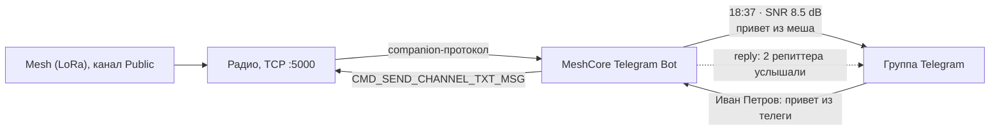

# MeshCore Telegram Bot — мост ZephCore/MeshCore ↔ Telegram

Двусторонний мост между mesh-каналом (радио ZephCore, роль companion) и группой в Telegram.
Сообщения из канала постятся в группу, сообщения группы уезжают в канал, и бот отвечает
reply-ом, сколько репиттеров услышало каждую отправку.



## Требования

- Радио с ролью **companion** и WiFi-компаньеном (`capabilities: wifi: true`, TCP :5000).
  USB/BLE-транспорты бот не поддерживает.
- Для счётчика репиттеров — прошивка ZephCore ≥ 1.18.1 с CLI-командой `send.heard`.
- Бот должен состоять в группе, а у бота должен быть **выключен privacy mode**
  (BotFather → `/setprivacy` → Disable), иначе он не видит обычные сообщения группы.
  Альтернатива — назначить бота админом группы.

## Настройка

| Переменная      | По умолчанию     | Что                                             |
|-----------------|------------------|-------------------------------------------------|
| `BOT_TOKEN`     | —, обязательна   | токен от @BotFather                              |
| `TARGET_CHAT_ID`| —, обязательна   | числовой id группы (у групп отрицательный, `-100…`) |
| `RADIO_ADDR`    | `127.0.0.1:5000` | `ip:port` радио                                  |
| `CHANNEL_NAME`  | `Public`         | имя mesh-канала (резолвится в индекс на радио)   |

`TARGET_CHAT_ID` — только числовой id, не `@username`. Узнать: переслать любое сообщение
группы боту `@userinfobot` или `@JsonBot`.

## Запуск

```bash
go build -o meshcore-telegram-bot .
export BOT_TOKEN="123456:ABC..."
export TARGET_CHAT_ID="-1001234567890"
export RADIO_ADDR="192.168.1.50:5000"
./meshcore-telegram-bot
```

## Формат сообщений

### mesh → Telegram

```
18:37 · SNR 8.5 dB
привет из меша
```

Первая строка — метаданные из фрейма: mesh-время сообщения (в часовом поясе машины с ботом)
и SNR. Если у отправителя не было часов (timestamp 0), время не показывается; если фрейм
старого формата (V2) — SNR не показывается. **Имя отправителя неизвестно**: протокол
канального сообщения его не несёт.

### Telegram → mesh

```
Иван Петров: привет из телеги
```

Ник — `first_name last_name`, иначе `@username`, иначе `id NNN`; режется до 32 байт,
чтобы не съесть текст. В mesh сообщение уходит от имени самого радио (`prefs.node_name`),
поэтому в Public участники видят текст от твоего узла. Тексты длиннее ~169 байт режутся
по границе символа.

## Счётчик репиттеров

Через 5 секунд после отправки из Telegram бот отвечает reply-ом на сообщение юзера:

- `2 репиттера услышали` / `1 репиттер услышал` / `5 репиттеров услышали`
- `никто не услышал`
- `нет данных о доставке`

Радио считает ретрансмиты нашего flood-пакета соседями за окно ~10 с
(`ContentionTracker::extractDupeCount`, тот же механизм, что у joystick UI),
а CLI `send.heard <ts>` отдаёт счётчик и **потребляет** замер (one-shot). Поэтому:

- повторный запрос того же `ts` → «нет данных»;
- опрос позже ~10 с → «нет данных»;
- ребут радио → «нет данных» (таблица отправок живёт в RAM);
- прошивка без `send.heard` → «нет данных».

## Поведение на границах

| Ситуация | Поведение |
|---|---|
| Радио офлайн | сообщения из TG не подтверждаются и остаются в Telegram; после переподключения бот их досылает. Доставка at-least-once — при сбоях возможны дубли |
| Первый старт после простоя | Telegram отдаёт бэклог за последние сутки — он уезжает в mesh шквалом (ничего не теряется) |
| Краш бота | offset не персистится, последняя неподтверждённая пачка может уехать повторно (дубли) |
| Медиа (фото, голос, стикеры), подписи к ним | игнорируются — пересылается только текст |
| Сообщения других ботов | игнорируются (защита от петель и ботовых войн) |
| Анонимные админы (GroupAnonymousBot) | игнорируются — Telegram помечает их как бота |
| Пробельный текст | пропускается |
| 429 / сетевая ошибка Telegram (mesh→TG) | до 3 попыток с паузой 2 с, дальше сообщение логируется и теряется |
| Два экземпляра бота | нельзя: Telegram отдаёт 409 Conflict, а радио отдаёт sync-очередь на двоих |
| Бот в нескольких группах | слушается только `TARGET_CHAT_ID`, остальные пропускаются |
| TCP :5000 | plaintext без аутентификации — только доверенная сеть |
| Время в заголовке | локальный часовой пояс машины с ботом |
| Нет ответа от радио на отправку | через 15 с запрос считается неудачным, сообщение остаётся в Telegram на повтор |

## Тесты

```bash
go test -race ./...
```

Фейковое радио поверх TCP покрывает: handshake и резолв канала, фильтр канала/типа текста,
push→pull докрутку, request/ack с «хвостовыми» ответами на таймаут, CLI `send.heard`
(включая мусорный ответ), монотонность timestamp отправок, форматирование сообщений
и склонения.
